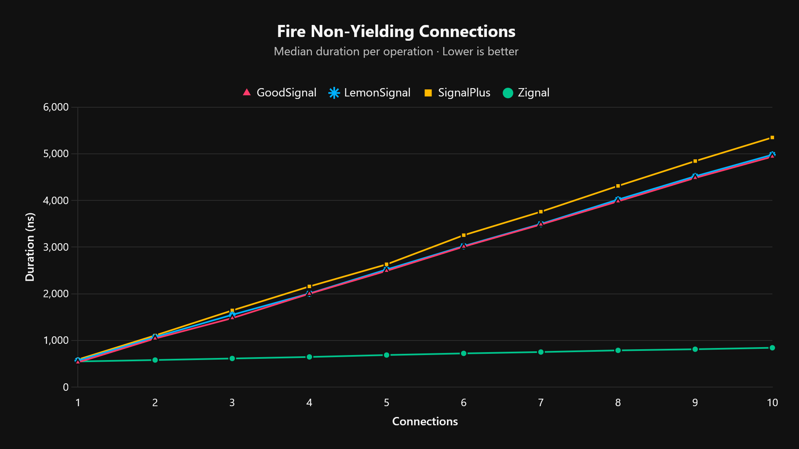
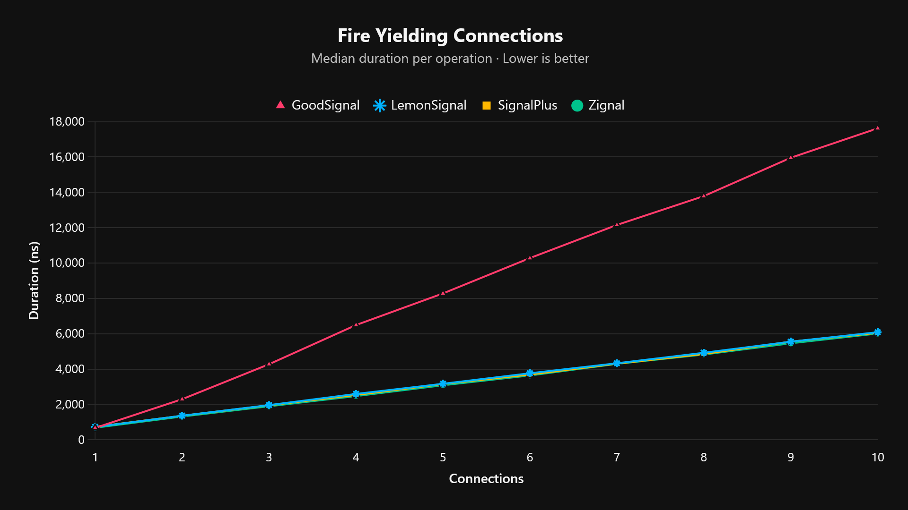
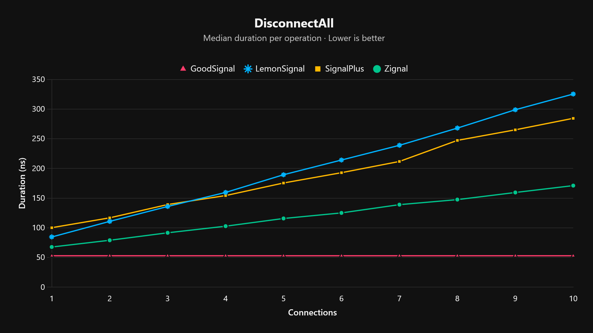
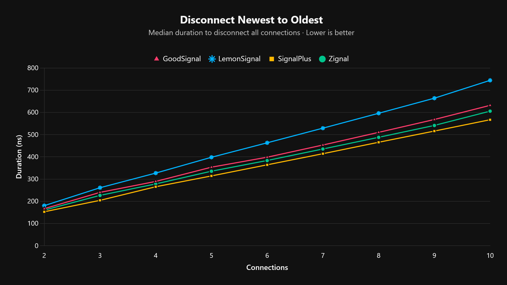
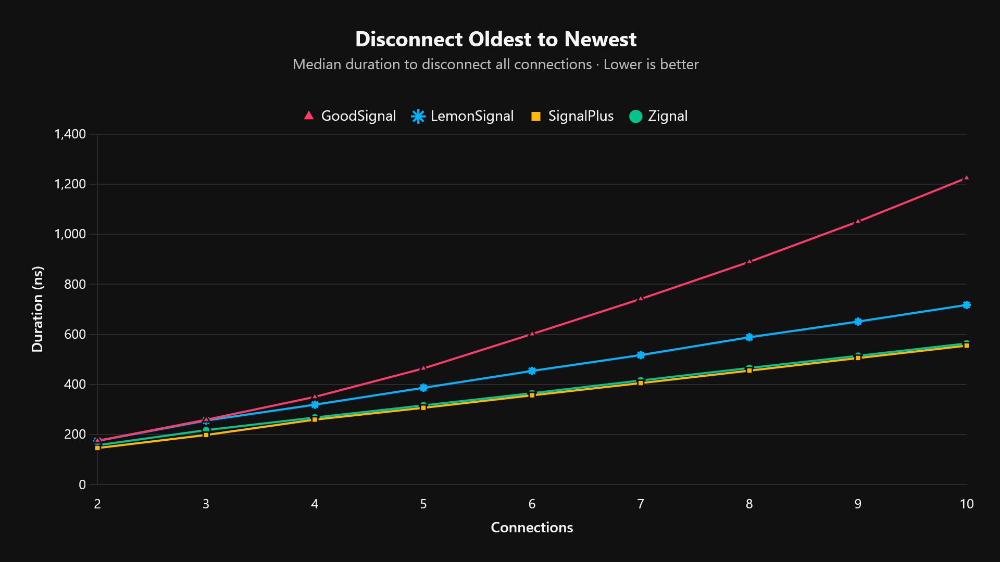

<h1 align="center">Zignal</h1>

<div align="center">

**A fast, lightweight, fully typed signal module for Roblox (Luau).**

</div>

---

Zignal is a signal implementation meant to replace Roblox's BindableEvents, and an alternative to modules like GoodSignal, LemonSignal, SignalPlus and many more. It is built around a doubly linked list of connections and a pool of reusable worker threads. Connecting and disconnecting are constant-time, and firing a signal doesn't create a new thread for every handler.

## Table of Contents

- [Features](#features)
- [Installation](#installation)
- [Quick Start](#quick-start)
- [API Reference](#api-reference)
  - [Zignal](#zignal-1)
  - [Signal](#signal)
  - [Connection](#connection)
- [Examples](#examples)
  - [Waiting for a signal](#waiting-for-a-signal)
  - [Running a handler once](#running-a-handler-once)
  - [Disconnecting a connection](#disconnecting-a-connection)
  - [Disconnecting everything](#disconnecting-everything)
- [Behavior Notes](#behavior-notes)
- [Upgrading](#upgrading)
- [Benchmarks](#benchmarks)
  - [Summary](#summary)
  - [Fire](#fire)
  - [Other operations](#other-operations)
  - [Metrics / Performance](#metrics--performance)
- [License](#license)

## Features

- **Typed.** Written in `--!strict`, with generic signatures like `Signal<number, string>`.
- **Fast `Fire`.** One pooled worker runs through all of a signal's handlers, so each extra connection adds very little to the cost of firing.
- **O(1) Connect and Disconnect.** Connections unlink themselves without searching the list.
- **Thread recycling.** Worker threads are pooled and reused, so repeated `Fire` calls don't keep creating coroutines.
- **Yield-safe.** A handler that yields never blocks the others. The remaining handlers are passed to another pooled worker.
- **Safe to disconnect while firing.** A connection disconnected earlier in the same `Fire` won't run.
- **Frozen.** The module table and the internal metatables are frozen, so they can't be modified by accident.

## Installation

1. Copy the contents of `Zignal.lua`.
2. In Roblox Studio, create a `ModuleScript` (for example in `ReplicatedStorage`) named `Zignal`.
3. Paste the code into it.

## Quick Start

```lua
local Zignal = require(path.to.Zignal)

local signal: Zignal.Signal<string, number> = Zignal.new()

local connection = signal:Connect(function(name, amount)
	print(name, amount)
end)

signal:Fire("Coins", 25) --> Coins 25

connection:Disconnect()
```

A signal that takes no arguments doesn't need any type parameters:

```lua
local ready: Zignal.Signal = Zignal.new()
```

## API Reference

### Zignal

| Member | Description |
| --- | --- |
| `Zignal.new<T...>()` | Creates a new `Signal`. |
| `Zignal.Signal<T...>` | Type of a signal that fires with the arguments `T...`. |
| `Zignal.Connection<T...>` | Type of a connection returned by `Connect` and `Once`. |

### Signal

| Method | Returns | Description |
| --- | --- | --- |
| `Signal:Connect(func)` | `Connection` | Runs `func` every time the signal fires. |
| `Signal:Once(func)` | `Connection` | Runs `func` the next time the signal fires, then disconnects itself. |
| `Signal:Wait()` | `T...` | Yields the current thread until the signal fires, then returns the fired arguments. |
| `Signal:Fire(...)` | none | Runs every connected handler with the given arguments. |
| `Signal:DisconnectAll()` | none | Disconnects every connection on the signal. |

### Connection

| Member | Description |
| --- | --- |
| `Connection.Connected` | `true` until the connection is disconnected. |
| `Connection:Disconnect()` | Disconnects the connection. Safe to call more than once. |

> [!NOTE]
> Fields that begin with an underscore (`_next`, `_previous`, `_callback`) are internal. Don't read or write them.

## Examples

The examples below use a signal created like this:

```lua
local Zignal = require(path.to.Zignal)

local signal: Zignal.Signal<string, number> = Zignal.new()
```

### Waiting for a signal

`Wait` yields, so call it from a thread that is allowed to yield (for example, one created with `task.spawn`).

```lua
task.spawn(function()
	local name, amount = signal:Wait()
	print("Received", name, amount)
end)

signal:Fire("Gems", 3)
```

### Running a handler once

```lua
signal:Once(function(name)
	print("First fire only:", name)
end)
```

### Disconnecting a connection

```lua
local connection = signal:Connect(function(name, amount)
	print(name, amount)
end)

print(connection.Connected) --> true
connection:Disconnect()
print(connection.Connected) --> false
```

### Disconnecting everything

```lua
signal:DisconnectAll()
```

## Behavior Notes

- **Handlers run newest-first.** `Connect` adds the new connection to the front of the list, so the most recently connected handler runs first.
- **`Fire` runs each handler immediately.** Handlers run synchronously, in order, on a pooled worker thread until they finish or yield. When a handler yields, `Fire` hands the remaining handlers to another worker and carries on, so a yielding handler never blocks the rest. `Fire` itself never yields.
- **Errors are isolated.** An error in one handler is reported to the output and doesn't stop the other handlers.
- **Disconnecting during a `Fire`.** If a handler disconnects another connection (or calls `DisconnectAll`) before that connection's turn, the disconnected connection doesn't run.
- **`DisconnectAll` doesn't resume waiters.** A thread yielded in `Signal:Wait()` when `DisconnectAll` is called stays suspended, because its connection will never fire.

## Upgrading

### To 2.1.0

There are no API changes. Replace your `Zignal` ModuleScript with the new `Zignal.lua`. The only difference you could notice is the private `Connection._function` field, which is now `Connection._callback`. Internal fields aren't part of the API.

### From 1.x

Version 2.0.0 changes what the module exposes:

- The module now returns a frozen table containing only `new`. Use `Zignal.new()`, and call methods on the signal objects you create. The methods are no longer reachable from the module table itself.
- Signal objects no longer have a `new` field, and the `Signal` type no longer includes `new`.
- The `Signal` and `Connection` metatables are frozen and can't be modified.
- `Zignal.Signal` and `Zignal.Connection` can now be written without `<>` when there are no arguments.

See the release notes for the full list of changes.

## Benchmarks

Median duration per operation in nanoseconds, so lower is better. Zignal v2.1.0 is compared against GoodSignal, LemonSignal and SignalPlus.

### Summary

| Operation | Fastest | Notes |
| --- | --- | --- |
| `Fire`, non-yielding handlers | **Zignal** from 2 connections up | 1.79x to 5.85x faster than the next best (GoodSignal). At 1 connection, GoodSignal is about 4% faster. |
| `Fire`, yielding handlers | **Zignal** from 2 connections up | Narrowly ahead of LemonSignal and SignalPlus (by up to about 5%), and 1.74x to 2.93x faster than GoodSignal. At 1 connection, GoodSignal is about 2% faster. |
| `Fire`, 0 connections | **Zignal** | 1.09x faster than GoodSignal |
| `Connect` | **Zignal** | 1.31x faster than GoodSignal |
| `Once` | **Zignal** | 1.32x faster than LemonSignal |
| `Wait` | **Zignal** | 1.32x faster than GoodSignal |
| `Disconnect` | SignalPlus | Zignal is second: 3.5% behind for a single connection, and 6.8% (newest to oldest) or 1.6% (oldest to newest) behind at 10 connections |
| `DisconnectAll` | GoodSignal | Constant time, but no `Connection.Connected` support. Zignal is second, 1.66x faster than SignalPlus and 1.90x faster than LemonSignal at 10 connections |
| `Create` | SignalPlus | 41.2 ns. Zignal, GoodSignal and LemonSignal are level at about 63 to 65 ns |

### Fire

**Non-yielding handlers.** Each extra connection adds roughly 33 ns to Zignal's `Fire`, compared with roughly 490 to 530 ns for the other three, so the gap widens with every connection. At 10 connections Zignal takes 843.6 ns against 4,938.1 ns for GoodSignal, the next best (5.85x faster, or 5.90x vs LemonSignal and 6.34x vs SignalPlus).



**Yielding handlers.** When a handler yields, the remaining connections are handed to a new worker, so each yielding handler costs a `task.spawn` call and the per-connection saving mostly disappears. Zignal is level with LemonSignal and SignalPlus, and 1.74x to 2.93x faster than GoodSignal.



### Other operations

| Benchmark (ns) | GoodSignal | LemonSignal | SignalPlus | Zignal |
| --- | ---: | ---: | ---: | ---: |
| Create | 63.0 | 65.4 | **41.2** | 62.9 |
| Connect | 196.6 | 220.4 | 265.8 | **150.6** |
| Once | 286.0 | 276.3 | 365.0 | **209.3** |
| Wait | 326.4 | 389.0 | 389.8 | **246.8** |
| Fire No Connections | 28.0 | 35.0 | 43.1 | **25.6** |
| Disconnect One | 86.4 | 89.1 | **77.1** | 79.8 |

GoodSignal's `DisconnectAll` runs in constant time (52.9 ns at any connection count) but doesn't support `Connection.Connected`. Zignal's is linear because it marks every connection as disconnected, which keeps `Connected` accurate and lets a `DisconnectAll` inside a handler stop the remaining handlers.

### Metrics / Performance

<details>
<summary>Show all results</summary>

**Fire, non-yielding connections**

| Connections | GoodSignal | LemonSignal | SignalPlus | Zignal |
| --- | ---: | ---: | ---: | ---: |
| 1 | **530.4** | 567.7 | 592.1 | 550.4 |
| 2 | 1041.3 | 1071.4 | 1108.2 | **581.0** |
| 3 | 1477.7 | 1548.1 | 1643.8 | **613.5** |
| 4 | 2001.1 | 2005.5 | 2157.8 | **646.5** |
| 5 | 2491.0 | 2519.2 | 2631.4 | **688.3** |
| 6 | 3009.6 | 3021.3 | 3255.7 | **722.6** |
| 7 | 3483.5 | 3495.5 | 3759.2 | **752.4** |
| 8 | 3980.4 | 4017.6 | 4311.7 | **787.6** |
| 9 | 4482.6 | 4517.0 | 4843.3 | **812.0** |
| 10 | 4938.1 | 4977.7 | 5349.0 | **843.6** |

**Fire, yielding connections**

| Connections | GoodSignal | LemonSignal | SignalPlus | Zignal |
| --- | ---: | ---: | ---: | ---: |
| 1 | **665.9** | 726.3 | 731.1 | 680.5 |
| 2 | 2290.8 | 1363.6 | 1357.6 | **1315.0** |
| 3 | 4271.3 | 1962.5 | 1948.0 | **1896.4** |
| 4 | 6485.8 | 2595.2 | 2534.7 | **2471.2** |
| 5 | 8276.0 | 3170.4 | 3153.2 | **3083.5** |
| 6 | 10276.6 | 3764.2 | 3688.9 | **3639.4** |
| 7 | 12149.9 | 4330.9 | 4307.1 | **4294.2** |
| 8 | 13783.6 | 4923.6 | 4852.0 | **4823.7** |
| 9 | 15954.0 | 5551.6 | 5548.2 | **5459.8** |
| 10 | 17618.6 | 6087.6 | 6050.0 | **6013.5** |

**DisconnectAll**

| Connections | GoodSignal | LemonSignal | SignalPlus | Zignal |
| --- | ---: | ---: | ---: | ---: |
| 1 | **52.9** | 84.5 | 100.1 | 67.6 |
| 2 | **52.9** | 110.8 | 116.7 | 79.0 |
| 3 | **52.9** | 135.9 | 139.1 | 91.6 |
| 4 | **52.9** | 159.6 | 154.2 | 102.7 |
| 5 | **52.9** | 189.4 | 175.4 | 115.7 |
| 6 | **52.9** | 214.2 | 192.8 | 125.1 |
| 7 | **52.9** | 239.0 | 211.7 | 139.0 |
| 8 | **52.9** | 268.0 | 247.2 | 147.5 |
| 9 | **52.9** | 298.9 | 265.0 | 159.5 |
| 10 | **52.9** | 325.4 | 284.4 | 171.1 |



**Disconnect, newest to oldest**

| Connections | GoodSignal | LemonSignal | SignalPlus | Zignal |
| --- | ---: | ---: | ---: | ---: |
| 2 | 166.5 | 180.2 | **152.8** | 160.1 |
| 3 | 240.0 | 260.9 | **204.2** | 226.4 |
| 4 | 289.3 | 326.8 | **265.4** | 278.0 |
| 5 | 353.4 | 398.0 | **314.1** | 335.3 |
| 6 | 398.3 | 463.1 | **364.1** | 383.4 |
| 7 | 453.2 | 529.1 | **414.1** | 435.3 |
| 8 | 510.2 | 596.0 | **465.6** | 487.8 |
| 9 | 568.0 | 663.9 | **516.0** | 541.3 |
| 10 | 631.7 | 744.2 | **567.0** | 605.5 |



**Disconnect, oldest to newest**

| Connections | GoodSignal | LemonSignal | SignalPlus | Zignal |
| --- | ---: | ---: | ---: | ---: |
| 2 | 174.9 | 174.2 | **146.0** | 157.1 |
| 3 | 258.9 | 255.7 | **198.2** | 217.6 |
| 4 | 350.1 | 319.0 | **259.5** | 267.8 |
| 5 | 463.9 | 386.3 | **306.7** | 316.3 |
| 6 | 601.3 | 453.8 | **356.6** | 364.9 |
| 7 | 741.4 | 517.1 | **405.4** | 415.9 |
| 8 | 889.6 | 588.2 | **455.2** | 465.6 |
| 9 | 1050.4 | 650.9 | **505.4** | 514.4 |
| 10 | 1224.6 | 717.3 | **554.9** | 563.7 |



</details>

## License

See [LICENSE](LICENSE).
